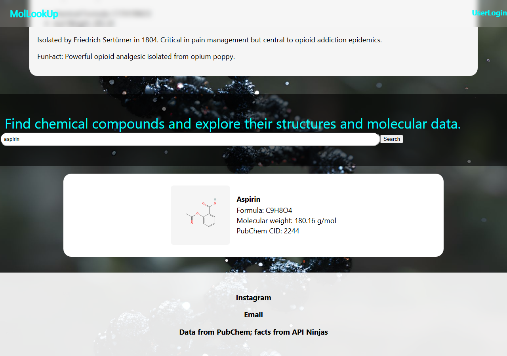

# MolLookUp

[](https://github.com/Jedges14/MolLookUp/actions/workflows/ci.yml)

Search for a drug or compound by name (or PubChem CID) and see its 2D structure, formula and molecular weight.
The React frontend talks only to the MolLookUp API. The API answers from Redis, then PostgreSQL, and only on a full
miss calls PubChem's PUG-REST API, through a rate-limited client (≤4 requests/s, retries with backoff).

**Live: https://mol-look-up.vercel.app** (API: https://mollookup-api.onrender.com/health). The API is on a free
plan and sleeps when idle, so the first search after a quiet spell can take up to a minute.

> Status: M0–M4 of [SPEC.md](SPEC.md). Hosting: Vercel (frontend), Render (API, Docker), Neon (Postgres), Upstash
> (Redis); see [docs/DEPLOY.md](docs/DEPLOY.md). Every number below is in [RESULTS.md](RESULTS.md) with the command that produced it.



## Results at a glance

| | Measured | How |
|---|---|---|
| Search latency, caching off → warm Redis | **2,779 ms → 1.9 ms mean (99.9% lower)** | 200 fixed queries, sequential, same machine |
| Warm Postgres (found names) | 3.5 ms mean | Redis flushed, Postgres kept |
| Load test | **200 concurrent virtual users: p95 189 ms, 0 errors, ~1.8k req/s** | k6, cache-only mode (no PubChem load), laptop |
| Tests | **129** (103 backend unit, 10 integration, 14 frontend, 2 E2E) | backend line coverage 96%, frontend 100% |

## Architecture

```
React (Vite) ──/api──► Express API (TypeScript) ──► Redis (hot cache: 24 h results, 10 min "not found", 7 d images)
                              │                        └─ miss ─► PostgreSQL (durable compounds + synonyms)
                              │                                      └─ miss ─► PubChem PUG-REST
                              │                                                 (token bucket ≤4 req/s, 3 attempts, 30 s timeout)
                              └──► /health, /metrics
```

Every response carries `X-Cache: redis | db | miss`. If Redis is down, the API keeps serving from Postgres.
`CACHE_ONLY=true` makes a full miss return 503 instead of calling PubChem (used for load tests).

## Run locally

Requires Docker.

```bash
cp .env.example .env              # optional: add a RapidAPI key for the daily fact (see docs/SECRETS.md)
docker compose up -d --build      # postgres, redis, api (runs migrations), web
cd backend && npm ci && cp .env.example .env && npm run seed   # optional: preload 25 molecules
```

Open http://localhost:5173. API: http://localhost:3001 (`/health`, `/api/compounds/search?q=aspirin`).

### Without Docker for the API

```bash
docker compose up -d postgres redis
cd backend && npm ci && cp .env.example .env && npm run migrate && npm run dev
cd frontend && npm ci && npm run dev
```

## API

| Endpoint | Returns |
|---|---|
| `GET /api/compounds/search?q=` | `{query, results: [{cid, name, formula, mw}]}` |
| `GET /api/compounds/:cid` | Full record incl. IUPAC name, SMILES, InChIKey, XLogP, synonyms |
| `GET /api/compounds/:cid/image` | 2D structure PNG proxied from PubChem, cached in Redis (`Cache-Control: max-age=86400`) |
| `GET /api/fact` | Daily science fact (503 if `RAPIDAPI_KEY` is unset) |
| `GET /health` | `{status, db, redis, cacheOnly}` (503 only if Postgres is down) |
| `GET /metrics` | JSON: request counts, p50/p95/p99 latency, cache hits per tier, hit ratio, PubChem request count |

Errors are always `{"error": {"code", "message"}}`: 400 invalid input, 404 not found, 502/503 PubChem trouble,
503 `CACHE_MISS` in cache-only mode.

## Tests

129 tests: 103 backend unit, 10 backend integration, 14 frontend, 2 end-to-end. Coverage is in [RESULTS.md](RESULTS.md).

```bash
cd backend  && npm test                # unit (no Docker needed)
cd backend  && npm run test:int        # integration: real Postgres + Redis via Testcontainers (needs Docker)
cd backend  && npm run test:coverage   # unit + integration with coverage
cd frontend && npm test                # Vitest + React Testing Library
docker compose up -d postgres redis && cd e2e && npm ci && npx playwright install chromium && npx playwright test
```

- **Unit:** query normalization, the token bucket (fake timers), PubChem parsing from recorded fixtures, the client's
  retry/backoff/batching, cache tiers, negative caching, cache-only mode, metrics, config, and the HTTP layer.
- **Integration:** the real API against real Postgres and Redis. Proves a repeated request makes zero PubChem calls,
  that the API survives a Redis outage, and that SQL-looking input is just data.
- **E2E:** Playwright searches "aspirin" and checks the structure image loads and the formula shows. The API talks to
  a local mock PubChem server, and the test fails if the browser contacts PubChem or RapidAPI directly.
- Nothing calls the real PubChem in tests or CI.

**CI** ([.github/workflows/ci.yml](.github/workflows/ci.yml)) runs on every PR and push to `main`: backend lint →
typecheck → unit + integration tests with coverage; frontend lint → tests with coverage → build; Playwright E2E
against Postgres/Redis service containers; and a Docker build of the API image (checked to run as non-root).

## Benchmarks

```bash
docker compose up -d postgres redis && (cd backend && npm ci && npm run build)
node bench/latency.mjs          # ~15-20 min; ~960 PubChem requests at <=4/s. Run off-peak, and rarely.
# load test: API in cache-only mode on :3201, then
docker run --rm -v "${PWD}/bench:/bench" -e BASE_URL=http://host.docker.internal:3201 grafana/k6:1.8.2 run /bench/load.js
```

See [RESULTS.md](RESULTS.md) for the exact setup, the raw JSON, and limitations.

Data: [PubChem](https://pubchem.ncbi.nlm.nih.gov/) (NCBI). Facts: API Ninjas via RapidAPI.
